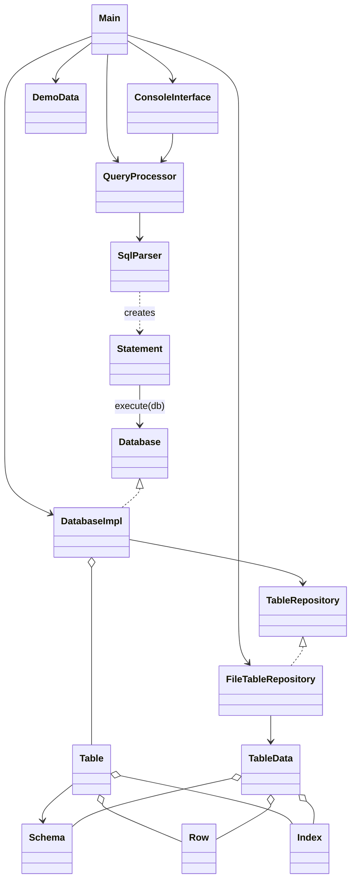
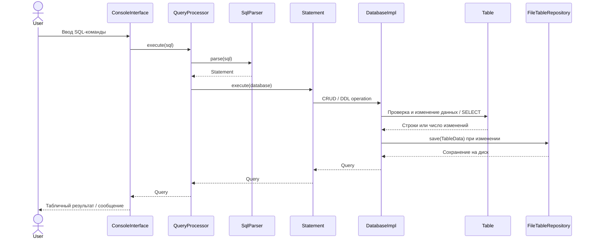
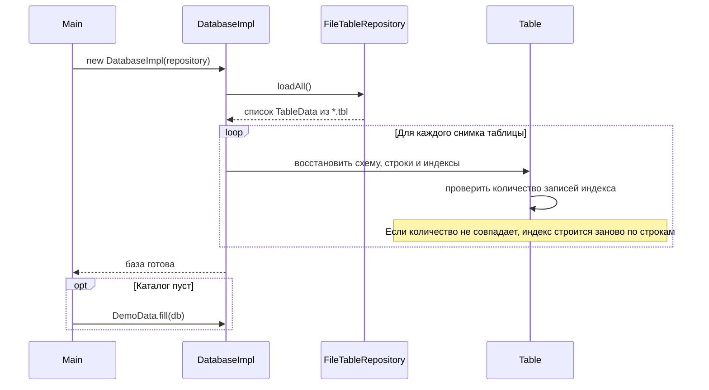

# Упрощённая СУБД на Java — лабораторная работа № 2

Упрощённая файловая система управления базами данных на Java. Движок не привязан к предметной области: таблицы создаются командой `CREATE TABLE`, поэтому в нём можно хранить данные любого вида. Для примера при первом запуске создаются демонстрационные таблицы.

## 1. Возможности

- Любое число таблиц, связанных по ключу (в демонстрационных данных — `heroes` и `items`).
- Типы данных: `INT`, `DOUBLE`, `STRING`, `DATE`, `BOOLEAN`.
- Первичные и внешние ключи с проверкой ссылочной целостности.
- Пакетная вставка записей и проверка уникальности первичного ключа.
- `SELECT`, `INSERT`, `UPDATE`, `DELETE`, а также `CREATE TABLE`, `DROP TABLE` и `CREATE INDEX`.
- Консольный ввод SQL-подобных команд и табличный вывод результатов.
- Сохранение схем, строк и вторичных индексов в файлы на диске; загрузка при старте.
- Индексация по одной колонке с использованием `TreeMap` для точечного и диапазонного поиска.
- Поддержка восстановления индекса из строк при обнаружении расхождения количества индексных записей с данными таблицы.

## 2. Структура базы данных

При первом запуске, если каталог базы пуст, создаются демонстрационные таблицы. Они нужны только как пример: любую другую структуру можно создать командой `CREATE TABLE`.

### `heroes`

| Колонка | Тип | Ограничение | Значение |
|---|---|---|---|
| `id` | `INT` | Первичный ключ | Идентификатор героя в демонстрационном наборе |
| `name` | `STRING` | — | Имя героя |
| `radiant` | `BOOLEAN` | — | Принадлежность к одной из двух сторон (`true`/`false`) |
| `hp` | `INT` | — | Текущие очки здоровья |
| `is_alive` | `BOOLEAN` | — | Жив ли герой |
| `gold` | `INT` | — | Количество золота |
| `kills` | `INT` | — | Убийства |
| `assists` | `INT` | — | Помощь в убийствах |
| `deaths` | `INT` | — | Смерти |

### `items`

| Колонка | Тип | Ограничение | Значение |
|---|---|---|---|
| `id` | `INT` | Первичный ключ | Идентификатор предмета в демонстрационном наборе |
| `name` | `STRING` | — | Название предмета |
| `owner_id` | `INT` | Внешний ключ → `heroes.id` | Идентификатор героя-владельца; `NULL`, если предмет не назначен герою |
| `cost` | `INT` | — | Стоимость предмета |
| `description` | `STRING` | — | Краткое описание |

Связь между таблицами: **один герой — ноль или несколько предметов**. `items.owner_id` ссылается на `heroes.id`. Внешний ключ может быть `NULL`. Нельзя удалить таблицу-родителя, пока на неё ссылается другая таблица; нельзя удалить героя, на которого ссылаются предметы.

После первоначального заполнения автоматически создаётся индекс `idx_items_owner` по `items.owner_id`. Дополнительные индексы пользователь создаёт командой `CREATE INDEX`.

## 3. Архитектура

Проект разделён на несколько слоёв.

| Пакет | Назначение | Основные классы |
|---|---|---|
| `app` | Точка входа, начальные данные и бенчмарк | `Main`, `DemoData`, `IndexBenchmark` |
| `parser` | Токенизация и разбор SQL-подобного языка | `Tokenizer`, `SqlParser`, `QueryProcessor` |
| `parser.statement` | Команды, созданные парсером (паттерн Command) | `SelectStatement`, `InsertStatement`, `UpdateStatement`, `DeleteStatement`, DDL-команды |
| `service` | Исполнение запросов, управление таблицами и консоль | `Database`, `DatabaseImpl`, `Table`, `Query`, `ConsoleInterface` |
| `model` | Схемы, строки, типы, условия, операторы и индексы | `Schema`, `Column`, `Row`, `Condition`, `Index` |
| `repository` | Сохранение и загрузка данных | `TableRepository`, `FileTableRepository`, `TableData` |
| `exception` | Типизированные ошибки СУБД | `DatabaseException` и наследники |

### Диаграмма классов (основные зависимости)



### Последовательность выполнения SQL-запроса



### Последовательность загрузки при запуске



### Как работает индекс

`model.Index` реализует структуру `TreeMap<Comparable, Set<Object>>`: ключом служит значение индексируемой колонки, а значением — набор первичных ключей строк. Набор нужен, потому что одинаковое значение может встречаться у нескольких записей. `NULL` в индекс не добавляется.

Для `SELECT ... WHERE` слой `DatabaseImpl` выбирает путь выполнения:

1. `primary_key = value` — поиск через `HashMap` первичных ключей.
2. Если по колонке есть вторичный индекс и оператор поддерживается (`=`, `<`, `<=`, `>`, `>=`), поиск выполняется через `TreeMap`.
3. Для `!=` и для неиндексированных колонок выполняется полный перебор строк.

При вставке, обновлении и удалении `Table` обновляет соответствующие индексные записи. Индексы входят в сериализуемый снимок таблицы и восстанавливаются вместе с ней.

## 4. Поддерживаемый язык запросов

Ключевые слова нечувствительны к регистру. Завершающая точка с запятой необязательна. Имена таблиц и колонок приводятся к нижнему регистру.

### `SELECT`

```sql
SELECT * FROM heroes;
SELECT name, gold FROM heroes WHERE gold > 2000;
SELECT id, name FROM heroes WHERE radiant = TRUE;
```

### `INSERT`

```sql
INSERT INTO heroes VALUES (6, 'Lion', FALSE, 600, TRUE, 900, 2, 3, 4);
INSERT INTO heroes (id, name, gold) VALUES (7, 'Drow Ranger', 1200);
INSERT INTO heroes (id, name, gold) VALUES (8, 'Axe', 700), (9, 'Lina', 1500);
```

При сокращённом списке колонок остальные поля получают `NULL`; поэтому первичный ключ нужно передавать всегда. Пакет вставки проверяется до фактического добавления строк.

### `UPDATE` и `DELETE`

```sql
UPDATE heroes SET gold = 3000 WHERE id = 2;
UPDATE heroes SET is_alive = FALSE WHERE hp = 0;
DELETE FROM items WHERE id = 4;
```

### Создание и удаление таблиц

```sql
CREATE TABLE matches (
    id INT PRIMARY KEY,
    match_date DATE,
    duration DOUBLE,
    is_ranked BOOLEAN
);

INSERT INTO matches VALUES (1, '2026-11-15', 42.5, TRUE);
DROP TABLE matches;
```

Внешний ключ задаётся после типа колонки:

```sql
CREATE TABLE inventory_demo (
    id INT PRIMARY KEY,
    owner_id INT REFERENCES heroes (id),
    item_name STRING
);
```

### Создание индекса

```sql
CREATE INDEX idx_heroes_gold ON heroes (gold);
SELECT id, name, gold FROM heroes WHERE gold >= 2500;
```

### Ограничения парсера

Это учебное подмножество SQL, а не полноценный SQL-движок. В одном `WHERE` поддерживается только одно сравнение; `AND`, `OR`, подзапросы, `JOIN`, `ORDER BY`, `GROUP BY`, агрегатные функции и транзакции не реализованы. `CREATE INDEX` поддерживает один столбец. Индексный поиск не использует `!=` — для него выполняется сканирование.

Допустимые имена типов: `INT`/`INTEGER`, `DOUBLE`/`FLOAT`, `STRING`/`VARCHAR`/`TEXT`, `DATE`, `BOOLEAN`/`BOOL`. Даты задаются строковым литералом в формате `yyyy-MM-dd`, например `'2026-11-15'`. Строки — в одинарных кавычках; одинарная кавычка внутри строки экранируется удвоением (`'O''Neil'`). Поддерживаются `TRUE`, `FALSE` и `NULL`.

## 5. Хранение данных и восстановление

- По умолчанию рабочий каталог — `data/` относительно текущей рабочей директории приложения.
- Для каждой таблицы создаётся файл `<имя_таблицы>.tbl`, например `heroes.tbl` и `items.tbl`.
- Файл содержит сериализованный объект `TableData`: схему, строки и индексы.
- При записи сначала создаётся временный файл `.tmp`, данные сбрасываются на диск, затем выполняется атомарное переименование (если файловая система его поддерживает).
- При запуске оставшиеся `.tmp`-файлы удаляются. Снимки `.tbl` загружаются в память; сохранённые индексы восстанавливаются.
- СУБД сохраняет изменённую таблицу после завершения команды изменения данных или DDL.

Атомарная замена файла снижает риск получить частично записанный снимок, но в проекте нет журнала транзакций, межтабличных транзакций и полной гарантии ACID. Для учебного проекта механизм восстановления ограничен файловой записью и очисткой временных файлов.

## 6. Сборка и запуск в Windows 11

### Требования

- JDK 21 или новее. Для проверки установки откройте PowerShell и выполните `java -version` и `javac -version`.
- Maven 3.8 или новее — только если планируется сборка через Maven. В проекте нет сторонних библиотек.

В исходном коде используются switch-выражения и API `List.getFirst()`, поэтому фактическая минимальная версия Java выше формального ограничения «Java 8+» из задания. В `pom.xml` выставлен `release 21`.

Все команды ниже предназначены для **PowerShell в Windows 11**. Перед их выполнением откройте PowerShell в корневой папке проекта — там, где находятся `pom.xml` и `README.md`.

### Проверка Java и Maven

```powershell
java -version
javac -version
mvn -version
```

Последняя команда нужна только для Maven-сборки. Если Maven не установлен, используйте компиляцию напрямую через `javac`, описанную ниже.

### Сборка через Maven

Из корневой папки проекта выполните:

```powershell
mvn clean package
```

После успешной сборки исполняемый JAR появится в `target`:

```powershell
java -jar .\target\minidb-1.0.0.jar
```

### Компиляция и запуск без Maven

Если Maven не установлен, проект можно собрать средствами JDK. Выполните команды в PowerShell из корневой папки проекта:

```powershell
New-Item -ItemType Directory -Force -Path .\target\classes | Out-Null
$files = Get-ChildItem -Path .\src\src\main\java -Recurse -Filter *.java | ForEach-Object { $_.FullName }
javac --release 21 -encoding UTF-8 -d .\target\classes $files
```

После успешной компиляции запустите приложение:

```powershell
java -cp .\target\classes app.Main
```

При старте приложение сначала выводит существующие таблицы: для каждой — название, названия колонок и первые 5 строк (если строк больше, указывается их общее число). Затем печатается краткая справка по синтаксису запросов и приглашение `>`. Приложение принимает по одной команде на строку.

Кроме SQL-команд доступны команды консоли:

| Команда | Действие |
|---|---|
| `help` | Показать справку по синтаксису |
| `tables` | Показать существующие таблицы и их первые 5 строк |
| `exit` | Завершить работу |

### Генерация Javadoc в Windows

Рекомендуемый вариант — прямая генерация средствами JDK с проверкой документации и HTML-разметки:

```powershell
New-Item -ItemType Directory -Force -Path .\target\site\apidocs | Out-Null
javadoc --release 21 -encoding UTF-8 -docencoding UTF-8 -charset UTF-8 -Xdoclint:all -Werror -d .\target\site\apidocs -sourcepath .\src\src\main\java app exception model org.example parser parser.statement repository service
```

Если команда завершилась без ошибок, откройте главную страницу документации:

```powershell
Start-Process .\target\site\apidocs\index.html
```

Также Javadoc можно сгенерировать через Maven:

```powershell
mvn javadoc:javadoc
```

В этом случае документация появится в `target/site/apidocs/index.html`. Готовая HTML-версия, если она включена в проект, находится в `docs/apidocs/index.html`. Для проверки именно исходных комментариев рекомендуется использовать прямую команду `javadoc` с параметрами `-Xdoclint:all -Werror`.

### Запуск бенчмарка индексации в Windows

Сначала скомпилируйте проект командами из подраздела «Компиляция и запуск без Maven» либо выполните `mvn clean package`. Если используется компиляция без Maven, запустите бенчмарк так:

```powershell
java -Xms512m -Xmx3g -cp .\target\classes app.IndexBenchmark
```

После Maven-сборки бенчмарк можно запустить из JAR:

```powershell
java -Xms512m -Xmx3g -cp .\target\minidb-1.0.0.jar app.IndexBenchmark
```

Бенчмарк работает в памяти и не затрагивает каталог `data/`. Параметр `-Xmx3g` задаёт максимальный объём памяти Java heap в 3 ГБ. Если на компьютере недостаточно свободной оперативной памяти, уменьшите лимит, например до `-Xmx2g`.

## 7. Тестирование производительности

Тест сравнивает `SELECT id, name, gold FROM heroes WHERE ...` при отсутствии вторичного индекса и после создания индекса по `heroes.gold`.

### Методика

- Размер таблицы: 10 000, 100 000 и 1 000 000 строк.
- Данные генерируются детерминированно (`Random(42)`), значения `gold` распределены по диапазону примерно с десятью строками на значение.
- Для каждого запроса выполняется 5 прогревочных запусков, затем 30 измеряемых запусков; в таблице приведена медиана времени одного запроса.
- Для выборок используются одинаковые последовательности ключей (`Random(7)`) в сценариях с индексом и без индекса.
- Сравниваются три фильтра: точное равенство `gold = K`, узкий верхний диапазон `gold >= max-4` и нижний диапазон `gold < 1% of range`.
- После измерений проверяется совпадение наборов первичных ключей результатов полного и индексного поиска. Порядок строк может различаться: полный перебор сохраняет порядок вставки, индекс возвращает результат в порядке значения индексного ключа.
- Время построения индекса измеряется отдельно. Для теста применяется `DatabaseImpl()` с `NoOpTableRepository`, поэтому дисковый ввод-вывод не попадает во время запросов.

### Результаты запуска на компьютере пользователя

Бенчмарк был запущен в Windows PowerShell командой:

```powershell
java -Xms512m -Xmx3g -cp .\target\classes app.IndexBenchmark
```

Ниже приведены результаты именно этого запуска. Время указано в миллисекундах; ускорение — отношение времени поиска без индекса ко времени поиска с индексом.

| Строк в таблице | Условие | Без индекса, мс | С индексом, мс | Ускорение | Строк в результате |
|---:|---|---:|---:|---:|---:|
| 10 000 | `gold = K` | 0,173 | 0,007 | ×24 | 11 |
| 10 000 | `gold >= max-4` | 0,088 | 0,015 | ×6 | 55 |
| 10 000 | `gold < 1% диапазона` | 0,095 | 0,024 | ×4 | 103 |
| 100 000 | `gold = K` | 1,682 | 0,007 | ×227 | 9 |
| 100 000 | `gold >= max-4` | 1,681 | 0,009 | ×179 | 43 |
| 100 000 | `gold < 1% диапазона` | 1,784 | 0,104 | ×17 | 1 003 |
| 1 000 000 | `gold = K` | 12,123 | 0,008 | ×1 497 | 6 |
| 1 000 000 | `gold >= max-4` | 12,646 | 0,005 | ×2 432 | 46 |
| 1 000 000 | `gold < 1% диапазона` | 14,231 | 3,291 | ×4 | 9 926 |

Время построения индекса в той же серии измерений:

| Количество строк | Время построения индекса, мс |
|---:|---:|
| 10 000 | 5,2 |
| 100 000 | 29,4 |
| 1 000 000 | 821,7 |

Результаты относятся к конкретному компьютеру и запуску. Время выполнения на другом компьютере может отличаться из-за характеристик процессора, сборщика мусора, JIT-компиляции и фоновой нагрузки.

### Вывод по производительности

Во всех трёх размерах таблицы индекс ускорил выполнение проверенных запросов. Наибольший выигрыш получен при точечном поиске и поиске по узкому верхнему диапазону. Для условия `gold < 1% диапазона` ускорение оказалось меньше, поскольку индекс должен собрать и вернуть больше подходящих строк: на миллионе записей найдено 9 926 строк, а время запроса с индексом составило 3,291 мс против 14,231 мс без индекса.

Построение индекса также требует времени: для миллиона строк оно заняло 821,7 мс. Следовательно, индекс особенно полезен для колонок, по которым часто выполняются повторяющиеся выборки. При оценке эффективности нужно учитывать не только ускорение `SELECT`, но и время построения, обновления и хранения индекса.

## 8. Распределение ответственности в команде

| Участник | Область ответственности |
|---|---|
| Михеев Никита Сергеевич | Ядро СУБД: парсер SQL, выполнение запросов, индексы, сериализация, оптимизация SELECT, архитектура слоёв. |
| Нуждин Алексей Петрович | Консольный интерфейс, документация, обработка ошибок и валидация ввода. |

## 9. Выводы

В рамках лабораторной работы реализована упрощённая файловая СУБД общего назначения. Данные хранятся в таблицах, связанных по ключу (демонстрационный набор состоит из двух таблиц), проверяются первичные и внешние ключи, реализованы операции `INSERT`, `SELECT`, `UPDATE`, `DELETE`, а также команды управления таблицами и индексами. Состояние базы и индексы сериализуются в отдельные файлы и восстанавливаются при запуске.

Для ускорения выборок реализован вторичный индекс на основе `TreeMap`. На компьютере пользователя индекс ускорил все три проверенных запроса на всех трёх объёмах данных: от ×4 до ×2 432 в зависимости от размера таблицы и условия поиска. Наибольшее ускорение получено для точечного поиска и узкого верхнего диапазона. Построение индекса для миллиона строк заняло 821,7 мс, поэтому при выборе колонок для индексации необходимо учитывать частоту запросов, селективность условия и стоимость обновления индекса.

## 10. Использованные источники

1. Oracle. Java Platform, Standard Edition 21 API Specification — `ObjectOutputStream`, `ObjectInputStream`, `Files`, `Path`, `TreeMap`, `LocalDate`: <https://docs.oracle.com/en/java/javase/21/docs/api/>
2. Oracle. Java Language Specification, Java SE 21: <https://docs.oracle.com/javase/specs/jls/se21/html/>
3. Apache Maven. Maven Getting Started Guide: <https://maven.apache.org/guides/getting-started/>
4. Oracle. Java Object Serialization Specification: <https://docs.oracle.com/en/java/javase/21/docs/specs/serialization/>
